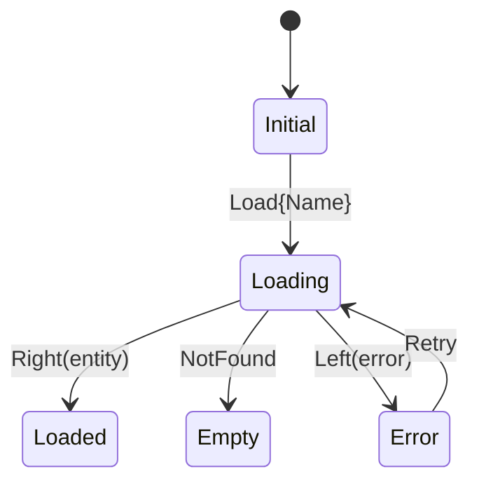

# Spec — {feature_name}

<!--
  Ce document est écrit par l'agent feature-specifier APRÈS que le dev a écrit les contrats dans le
  code (commit « contracts (by Thibault) »), à partir du cadrage validé. Il décrit ces contrats sans
  les changer et écrit tout ce qu'ils ne disent pas. Tests, implémentation et QA en découlent.

  Règles d'écriture :
  - Les sections 4 à 8 sont CONSOMMÉES PAR DES AGENTS ET DES SCRIPTS. Elles doivent
    être précises, complètes et non ambiguës. Pas de "à définir", pas de "etc.".
  - Les contrats sont dans le code du dev : la section 5 y renvoie (fichier:ligne), sans recopier.
  - Les payloads sont des EXEMPLES RÉELS : valeurs plausibles, tous les champs, y compris
    les nullables et les cas limites.
  - La section 10 doit être VIDE à la validation. Une question ouverte = spec pas finie.
  - Supprimer les commentaires HTML une fois la section remplie.
-->

| | |
|---|---|
| **Feature** | `{feature_name}` |
| **Package** | `{package_path}` |
| **Branche** | `feature/{feature_name}` |
| **Base** | `{base_branch}` |
| **Statut** | brouillon → validée le {date} |

---

## 1. Contexte & objectif

<!-- Un paragraphe. Le problème utilisateur, pas la solution. Pourquoi maintenant. -->

## 2. Périmètre

### Inclus

<!-- Liste fermée de ce que la feature fait. Chaque item doit se retrouver dans au moins un scénario de la section 4. -->

- 

### Exclu (explicitement)

<!-- Ce qu'on pourrait croire inclus et qui ne l'est pas. Ce qui est reporté à une itération suivante. -->

- 

## 3. Parcours & états d'écran

<!--
  Un bloc par écran ou par dialogue. Pour chaque écran, les quatre états sont obligatoires
  (Loading / Error / Empty / Loaded) — "N/A" avec justification s'il n'y en a pas.
  Wireframe ASCII pour le Loaded. Navigation entrante et sortante.
-->

### Écran : {ScreenName}

- **Route** : `/{route}` — paramètres : 
- **Entrée depuis** : 
- **Sortie vers** : 

| État | Rendu | Actions disponibles |
|---|---|---|
| Loading | | |
| Error | | |
| Empty | | |
| Loaded | voir wireframe | |

```
┌────────────────────────────────┐
│                                │
│                                │
└────────────────────────────────┘
```

## 4. Scénarios d'acceptation (Gherkin)

<!--
  LA PARTIE DURABLE. Recopiés tels quels dans test/{feature_name}.feature et
  exécutés via bdd_widget_test, puis rejoués sur device via Maestro.

  - Un scénario = un comportement observable par l'utilisateur.
  - La phrase d'un scénario ne promet que ce que ses steps vérifient. Chaque step est déclarée, n'a
    qu'une lecture, Given pour un état, Then pour un résultat observable. (learn 2026-10-27, spec_scenario_overclaims + bdd_step_semantics)
  - Un scénario par comportement C<n> du cadrage, qui reprend chaque étape de sa séquence
    (action, réponse du serveur, résultat visible) ; archi.json → sequences les relie.
  - Couvrir chaque item de la section 2 "Inclus".
  - Couvrir chaque état de la section 3 (au moins un scénario Error, un Empty).
  - Les steps référencent les widgets par leur clé de la section 5 (keys.dart),
    jamais par leur texte affiché (localisé, donc instable).
  - Formulation en anglais (convention bdd_widget_test), phrases courtes.
-->

```gherkin
Feature: {Feature name}

  Background:
    Given the app is running

  Scenario: 
    Given 
    When 
    Then 

  Scenario: shows an error when 
    Given 
    When 
    Then 

  Scenario: shows an empty state when 
    Given 
    When 
    Then 
```

## 5. Contrats

<!--
  Écrits par le dev dans le code (commit « contracts (by Thibault) » — {sha}). Cette section ne
  recopie aucune signature : une ligne par contrat, fichier:ligne, ce qu'il déclare, le C<n> qu'il
  sert. Le test-writer lit les fichiers, l'implementer les respecte. Un contrat qui empêche un
  comportement du cadrage n'est pas contourné ici : il va dans « Contrats à revoir par Thibault »
  du rapport du specifier.
-->

| Contrat | Fichier:ligne | Déclare | Sert |
|---|---|---|---|
| `{Name}Repository.fetch` | `lib/src/domain/repository/{feature_name}_repository.dart:5` | `Future<Either<ErrorEntity, {Name}Entity>> fetch(String id)` | C1, C3 |
| `{Name}State` | `lib/src/presentation/{screen}/bloc/{name}_state.dart:4` | sealed : Initial, Loading, Loaded, Empty, Error | C1–C4 |
| `{Name}Keys` | `lib/src/presentation/keys.dart:1` | page, loading, error, errorRetry, empty | §4 |

<!--
  Clés de widgets (keys.dart) — trois consommateurs :
  - widget tests   : find.byKey(ValueKey({Name}Keys.errorRetry))
  - flows Maestro  : tapOn: { id: "{feature_name}_error_retry" }  (Semantics identifier)
  - implémentation : Semantics(identifier: {Name}Keys.errorRetry, child: X(key: ValueKey({Name}Keys.errorRetry)))
  Maestro ne voit PAS les Key Flutter, seulement les Semantics identifiers : l'implémentation pose les deux.
  Chaque clé citée en §4 doit exister dans keys.dart.
-->

## 6. Données

<!--
  Sans cette section, le test-writer ne peut pas tester les mappers ni les data sources.
  Un exemple RÉEL par payload, avec tous les champs. Les cas limites en plus (champ null,
  liste vide, chaîne vide) s'ils existent.
-->

### Payloads remote

**`{Name}DataModel`** — réponse de `{endpoint ou collection Appwrite}` :

```json
{
  "$id": "abc123",
  "name": "Exemple",
  "createdAt": "2026-09-25T10:00:00.000Z",
  "optionalField": null
}
```

Cas limites :

```json
{ "$id": "abc124", "name": "", "createdAt": "2026-09-25T10:00:00.000Z", "optionalField": null }
```

### Schéma local (Isar)

<!-- Si data source locale. Sinon "N/A". Les DAOs vivent dans features/local_storage/ (cf. create_feature_rules.md). -->

N/A

### Mapping

| Source (`DataModel`) | Cible (`Entity`) | Règle |
|---|---|---|
| `$id` | `id` | direct |
| `name` | `name` | `trim()` ; vide → conservé vide, jamais null |
| `createdAt` | `createdAt` | ISO 8601 → `DateTime.parse`, UTC |

## 7. Erreurs

<!-- Chaque ErrorEntity possible, d'où elle vient, et ce que l'UI en fait. C'est la spec des scénarios Error. -->

| Erreur | Origine | Comportement UI | Retry possible |
|---|---|---|---|
| `NetworkError` | remote data source | `{Name}Error` + message générique + bouton retry | oui |
| `NotFoundError` | remote data source | `{Name}Empty` | non |
| `UnauthorizedError` | remote data source | redirection login (géré par `error` package) | non |

## 8. Architecture

<!-- Décisions structurelles. La map des dépendances est vérifiée par le gate `deps`. -->

- **Package** : nouveau `features/{feature_name}` / extension de `features/{existing}` — justification :
- **Packages partagés utilisés** : `core`, `design`, `l10n`
- **Dépendances inter-features** (le gate `deps_features` vérifie que chacune est nommée ici) :
  - `{autre_feature}` — pourquoi, et pourquoi ça ne passe pas par `core`
- **Dépendances hébergées ajoutées** (pub.dev) : aucune | `{package}` — pourquoi, dernière release le {date}, alternative rejetée
- **Direction des couches** : `presentation → domain ← data`, `injection → *`. Aucune exception.
- **DI** (Riverpod, `lib/src/injection/{feature_name}_di.dart`) : providers privés pour data sources et repository, publics pour use cases et BLoC.
- **Code existant déplacé ou découpé** : aucun | `fichier:symbole` — testé : oui / non (non → tests de caractérisation écrits d'abord, `create_test.md` §9). (learn 2026-10-27, refactor_moved_code_without_tests)
- **Routes** (`features/router`) : 
- **Clés l10n** (`features/l10n`, ARB) : 
- **Events analytics** (`package:core/analytics.dart`) : 
- **Services existants réutilisés** (ne pas réinventer) : 

<!--
  Pas de vue d'architecture : la structure est dans les contrats du dev. Les séquences par scénario
  sont dans cadrage.md ; `archi.json` (à côté de cette spec, format :
  ~/.claude/commands/templates/flutter/feature_archi_example.json) relie seulement chaque C<n> à son
  scénario de §4. Seul diagramme gardé ici : la machine d'états de chaque BLoC.
-->

**États du BLoC** (un diagramme par BLoC)



## 9. Package et dépendances

<!--
  Ce que les contrats ne montrent pas, et seulement ça. Format parsé par le rapport HTML et
  l'orchestrateur : ne pas changer les colonnes.

  - Package (nouveau / extension de …) et dépendances (pub.dev, inter-features) : tranchés au
    cadrage, statut `validée`.
  - Une dépendance découverte en écrivant la spec : statut `proposée`, avec une alternative RÉELLE ;
    le dev la tranche au point d'étape « spec ».
  - Jamais Stream/Future, découpage des BLoCs, data sources, emplacement d'une logique : c'est dans
    le code du dev. Jamais une question qu'une règle tranche, jamais la dette du code existant.
  - ID stable (A1, A2…), jamais renuméroté.
-->

| ID | Sujet | Décision | Alternative | Raison | Statut |
|---|---|---|---|---|---|
| A1 | Package | | | | validée |

## 10. Questions ouvertes

<!-- DOIT ÊTRE VIDE à la validation. Sinon, la spec n'est pas finie. -->

_Aucune._
